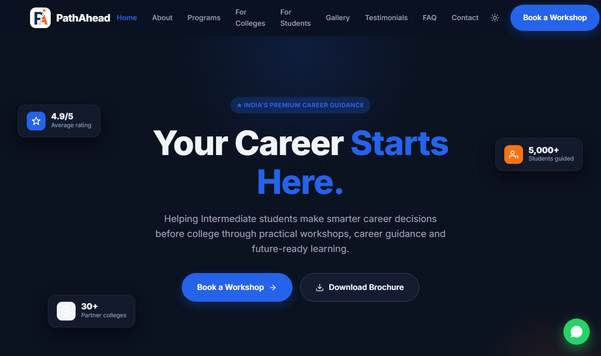
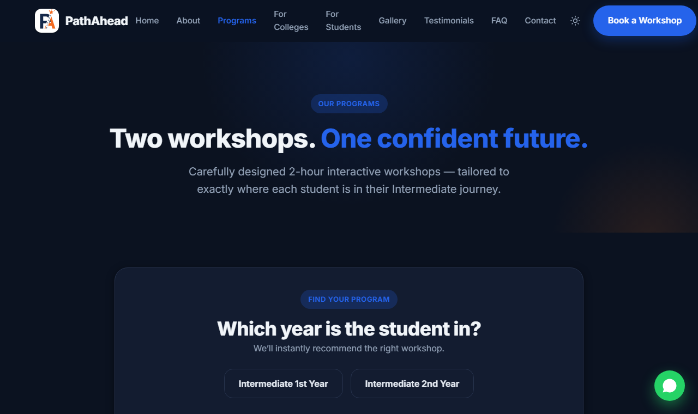
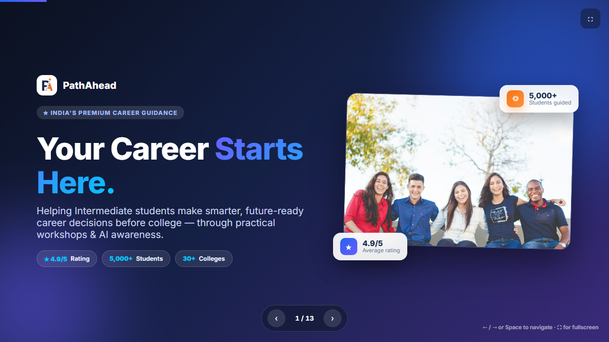
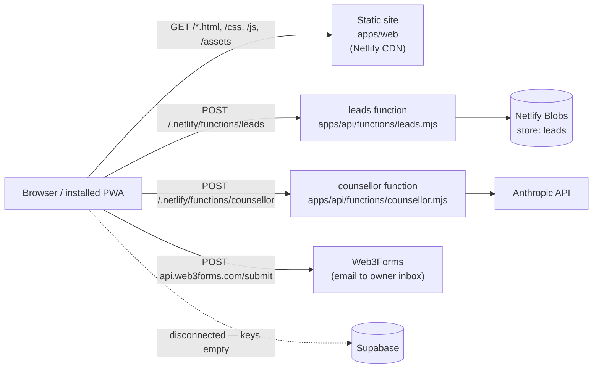

<div align="center">


# PathAhead

### *Your Career Starts Here.*

A premium, responsive, production-ready website for **PathAhead** — a career-guidance platform that runs career-awareness workshops for Intermediate (1st & 2nd year) students across India.

<br/>


</div>

<br/>

<div align="center">
  
</div>

---

## 📖 About

**PathAhead** helps students make smarter, future-ready career decisions *before* college — through practical, on-campus workshops covering career awareness, AI & technology, engineering branches and personalised career planning.

This repository contains the complete brand website **plus** a full promotional kit (presentation, brochure, tri-fold pamphlet and one-pager). The site is a **zero-build static site** — pure HTML, CSS and vanilla JavaScript with **no build step and no frameworks** — backed by two small **Netlify Functions** (lead store and AI career counsellor).

---

## ✨ Features

| | |
|---|---|
| 🎨 **Premium, modern UI** | Apple / Stripe-inspired design, gradients, glassmorphism, soft shadows |
| 🌗 **Dark mode** | System-aware theme toggle that remembers your choice (no flash) |
| 📱 **Fully responsive** | Verified on mobile, tablet and desktop |
| 📝 **Working forms** | College inquiry, student registration, contact & newsletter — with validation |
| 📧 **Email delivery** | Every submission is emailed via **Web3Forms** |
| 🗄️ **Lead store + Admin** | Submissions are stored server-side in **Netlify Blobs** by the `leads` function; `/admin.html` reads them back after a server-checked passcode (`ADMIN_PASSCODE`) |
| 🤖 **AI career counsellor** | Chat widget backed by the `counsellor` function (Anthropic API, key held server-side) |
| ⚡ **PWA** | Installable, works offline (service worker + manifest) |
| 🔍 **SEO ready** | Per-page meta, Open Graph & Twitter cards, JSON-LD, sitemap, robots, custom 404 |
| ♿ **Accessible** | Semantic HTML, keyboard navigation, ARIA, reduced-motion support |
| 💬 **Extras** | Floating WhatsApp button, scroll animations, animated counters, accordion FAQ |

---

## 🖼️ Screenshots

<div align="center">

| Home | Programs |
|:---:|:---:|
|  |  |

**Presentation deck**



</div>

---

## 🛠️ Tech Stack

- **Frontend:** HTML5, CSS3 (custom design system with CSS variables), Vanilla JavaScript
- **Backend:** [Netlify Functions](https://docs.netlify.com/functions/overview/) (Node 22, bundled with esbuild) + [Netlify Blobs](https://docs.netlify.com/blobs/overview/) for the lead store
- **AI:** Anthropic API via `@anthropic-ai/sdk` (server-side only)
- **Email:** [Web3Forms](https://web3forms.com)
- **Database:** [Supabase](https://supabase.com) — *currently disconnected*: the old project was deleted, the keys in `js/config.js` are empty, and the code skips it cleanly
- **PWA:** Web App Manifest + Service Worker
- **Fonts:** Inter · **No frameworks, no build tools for the site**

---

## 🏗️ Architecture



```
Browser ──► apps/web (static, Netlify CDN)
   │
   ├──► /.netlify/functions/leads      ──► Netlify Blobs   (apps/api/functions/leads.mjs)
   ├──► /.netlify/functions/counsellor ──► Anthropic API   (apps/api/functions/counsellor.mjs)
   ├──► Web3Forms                      ──► owner's inbox   (public form key in js/config.js)
   └╌╌► Supabase                           currently disconnected
```

Only `apps/web` is published, so every page keeps its URL at the site root (`/about.html`, `/sw.js`, `/roadmaps/*.pdf`) and nothing outside it — scripts, docs, `package.json` — is downloadable.

---

## 📂 Project Structure

```
PathAhead/
├── apps/
│   ├── web/                       # Everything the site serves (Netlify publish dir)
│   │   ├── index.html  about.html  programs.html  for-colleges.html  for-students.html
│   │   ├── gallery.html  testimonials.html  faq.html  contact.html  roadmaps.html
│   │   ├── career-roadmap.html    # Career Builder
│   │   ├── *-roadmap.html         # 12 roadmap pages (generated — see roadmaps/)
│   │   ├── admin.html  404.html
│   │   ├── css/styles.css         # Full design system + dark mode
│   │   ├── js/
│   │   │   ├── main.js            # Shared nav/footer, interactions, form pipeline, chat widget
│   │   │   ├── motion.js          # Motion layer (progressive enhancement)
│   │   │   ├── config.example.js  # Template for config.js
│   │   │   └── config.js          # Public client keys (committed deliberately)
│   │   ├── career-data/           # Career Builder data (branches, domains, years, …)
│   │   ├── roadmaps/              # Roadmap PDFs + build_roadmaps.py generator
│   │   ├── ai-ml-roadmap/         # AI/ML roadmap PDF and working files
│   │   ├── assets/                # Logo, icons, images, screenshots + promo kit
│   │   └── manifest.webmanifest  sw.js  sitemap.xml  robots.txt
│   └── api/
│       └── functions/             # Netlify Functions → /.netlify/functions/*
│           ├── leads.mjs          # Lead store (Netlify Blobs) + admin API
│           └── counsellor.mjs     # AI career counsellor (Anthropic API)
├── scripts/                       # Maintenance scripts (Node)
│   ├── build-dragdrop.mjs         # Self-contained zip for manual Netlify upload
│   ├── set-domain.mjs             # Rewrite canonical/OG/sitemap URLs for a new domain
│   └── add-courses.mjs            # One-off: add non-engineering courses to career-data
├── docs/
│   ├── DEPLOY.md                  # Netlify deploy guide
│   └── SETUP.md                   # Integration / go-live guide
├── netlify.toml                   # publish = apps/web, functions = apps/api/functions
├── package.json  package-lock.json # Function dependencies only (installed by Netlify)
├── LICENSE
└── README.md
```

---

## 🚀 Getting Started

```bash
# 1. Clone
git clone https://github.com/saatwik-1157/project_PathAhead.git
cd project_PathAhead

# 2. Run the site — any static server works, pointed at apps/web
python -m http.server 8000 --directory apps/web
#    → open http://localhost:8000
```

> Or simply **open `apps/web/index.html`** in a browser — no server required.
> A plain static server does not run the Netlify Functions, so the lead store
> and AI counsellor degrade gracefully (email via Web3Forms still works).
> To run the functions locally too: `npm install` then `npx netlify dev`.

### Maintenance scripts

```bash
node scripts/set-domain.mjs https://your-site.netlify.app   # switch canonical domain
node scripts/build-dragdrop.mjs                              # build PathAhead-site.zip for manual upload
python apps/web/roadmaps/build_roadmaps.py                  # regenerate the 12 roadmap pages
```

---

## 🔧 Configuration

Client-side integration keys live in **`apps/web/js/config.js`**, which is committed deliberately — they are public by design:

```js
window.PATHAHEAD_CONFIG = {
  web3formsKey:    "your-web3forms-key",   // https://web3forms.com (public form key)
  supabaseUrl:     "",                     // empty — Supabase is currently disconnected
  supabaseAnonKey: ""
};
```

Server-side secrets are **Netlify environment variables**, never files:

| Variable | Used by |
|---|---|
| `ANTHROPIC_API_KEY` | `counsellor` function |
| `ADMIN_PASSCODE` | `leads` function (admin list/delete) |

More detail is in **[docs/SETUP.md](docs/SETUP.md)** and **[docs/DEPLOY.md](docs/DEPLOY.md)**.

---

## 🌐 Deployment

1. **Netlify, git-connected (recommended):** import the repository; `netlify.toml` already sets `publish = "apps/web"` and the functions directory `apps/api/functions`. Leave the dashboard build settings empty so the file is authoritative. Every push redeploys.
2. **Manual upload:** `node scripts/build-dragdrop.mjs` produces `PathAhead-site.zip` with the functions pre-bundled — extract and drop the folder on Netlify.
3. After a domain change run `node scripts/set-domain.mjs <url>`.

Full guide: **[docs/DEPLOY.md](docs/DEPLOY.md)**.

---

## 📎 Promotional Kit

Alongside the site, this repo ships a full marketing kit — all in `apps/web/assets/`:

- 🎬 **Presentation** — `PathAhead-Deck.html` (fullscreen, arrow-key navigable)
- 📄 **Brochure** — `PathAhead-Brochure.html` (premium scrolling page)
- 📑 **Pamphlet** — `PathAhead-Pamphlet.html` + **`.pdf`** (print-ready tri-fold)
- 📃 **One-Pager** — `PathAhead-OnePager.html`

---

## 👥 Authors

Designed & developed by **two members**:

<table>
  <tr>
    <td align="center">
      <a href="https://github.com/saatwik-1157"><b>Saatwik Sairaam Vasamsetti</b></a><br/>
      <a href="https://github.com/saatwik-1157">@saatwik-1157</a>
    </td>
    <td align="center">
      <a href="https://github.com/Nirisha22"><b>Nirisha</b></a><br/>
      <a href="https://github.com/Nirisha22">@Nirisha22</a>
    </td>
  </tr>
</table>

---

## 📄 License

Released under the **MIT License** — see [LICENSE](LICENSE).

<div align="center">

**PathAhead — Your Career Starts Here.** ⭐

*If you find this project useful, consider giving it a star!*

</div>
